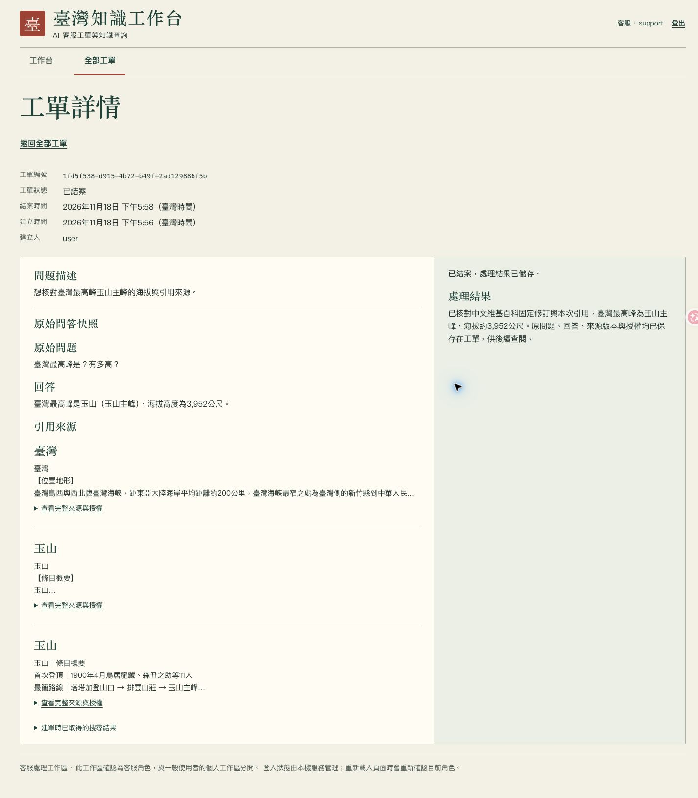

# AI 客服工單與知識查詢

一套可在本機執行的客服工作台，以中文維基百科的臺灣精選條目提供知識搜尋與 Gemini 問答。使用者可以核對引用，也可以把問題轉成工單，交由客服處理。介面以米白紙色、森林綠與磚紅字印，呈現臺灣地方刊物的閱讀感。



*臺灣知識工作台的實際結案工單，展示玉山問答、可展開的來源與授權，以及已儲存的處理結果。*

## 主要功能

- **知識搜尋**　搜尋臺灣地理、城市、景點、文化與交通的精選資料；共用相關性排序，手動搜尋最多 20 段，來源可原生展開查看全文與授權。
- **AI 問答**　Gemini 每次工具搜尋最多取得 8 個完整片段，支援追問；回答與引用經後端驗證後，再以逐字效果呈現。
- **工單處理**　使用者可將問題轉成工單，保存建單當下的回答與證據。客服可查看工單、填寫處理結果並結案，提單者可回查結果。

示範知識涵蓋臺灣、臺北、臺南、玉山、日月潭、阿里山、故宮、高鐵與曾文水庫九份條目、181 個正文片段，各自附上原文修訂連結與授權，詳見[資料來源與授權](knowledge/SOURCES.md)。

## 使用技術

| 層面 | 技術 |
| --- | --- |
| 前端 | Nuxt 4、Vue 3、TypeScript |
| 後端 | Python、FastAPI、Pydantic |
| AI 問答 | Gemini、Google GenAI SDK（Interactions API） |
| 資料庫與本機環境 | PostgreSQL 18、Docker Compose |
| 測試 | pytest、Node.js 內建測試工具 |

## 啟動與測試

請在專案根目錄執行。需要支援 POSIX 檔案權限的環境、支援 `up --wait` 的 Docker Compose，以及 Python 3.10 以上版本。

### 本機啟動

```sh
./bin/local up
```

開啟 [客服工作台](http://127.0.0.1:8020/)，即可看到啟用畫面。要操作完整問答，請準備 Gemini API Key，在終端執行下列命令。驗證成功後，在頁面按「重新確認狀態」。`user` 與 `support` 的示範密碼位於本機的 `.local/demo-passwords`。

```sh
./bin/local set-key
./bin/local verify-key
./bin/local import-knowledge
```

### 手動驗證

1. **提問並核對引用。** 用 `user` 登入後輸入「玉山主峰的海拔是多少？」。確認回答約 3,952 公尺，核對實際引用的臺灣或玉山文件（`body-v2` 版本）摘錄確實支持該海拔，不限定單一片段識別，並附有維基百科原文與授權。
2. **建立工單。** 在該題按「建立工單」，確認預填的描述後送出。記下單號並核對明細中的原問題、回答與引用。
3. **客服結案。** 登出後用 `support` 登入，在「全部工單」開啟同一筆工單，填寫處理結果並按「結案」。確認狀態顯示「已結案」。
4. **查看處理結果。** 再用 `user` 登入，從「我的工單」開啟同一筆工單，確認處理結果、結案時間和原始證據。

### 自動化測試

```sh
./bin/local check
./bin/local test
./bin/local stop-test
```

目前 265 項後端與 13 項前端測試通過。後端測試使用隔離的測試資料庫與合成憑證。前端測試與建置檢查需要 Node.js 24.22.2 以上的 24.x 版本。

```sh
cd frontend
npm ci --no-audit --no-fund
node --test tests/*.test.mjs
npm run format:check
npm run typecheck
npm run generate
```

[完整操作與測試手冊](docs/guide.md)
